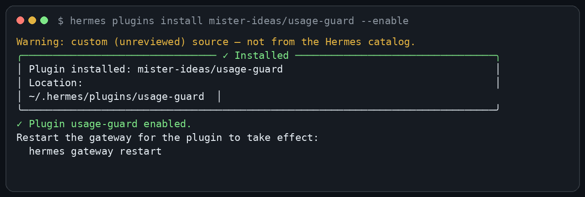
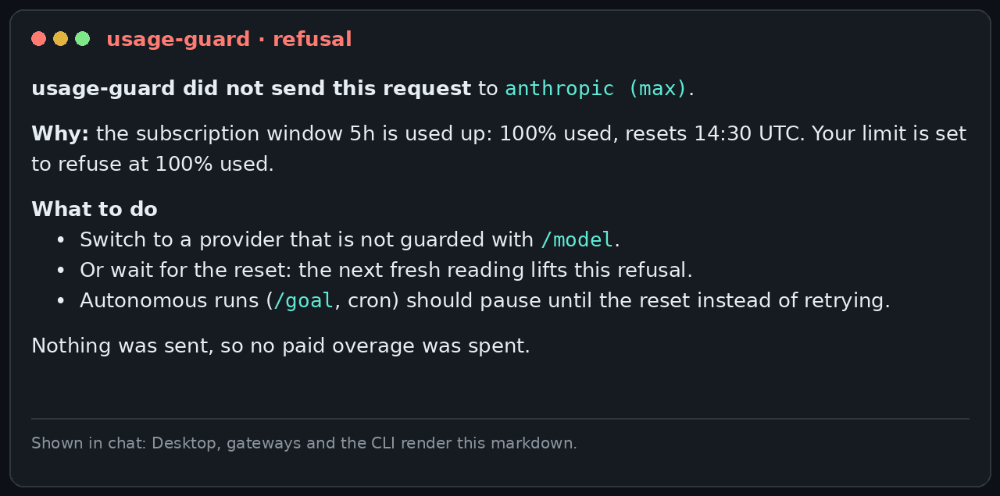
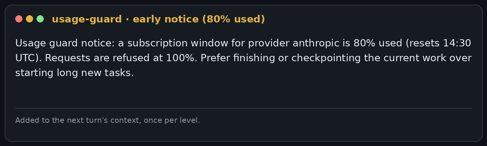
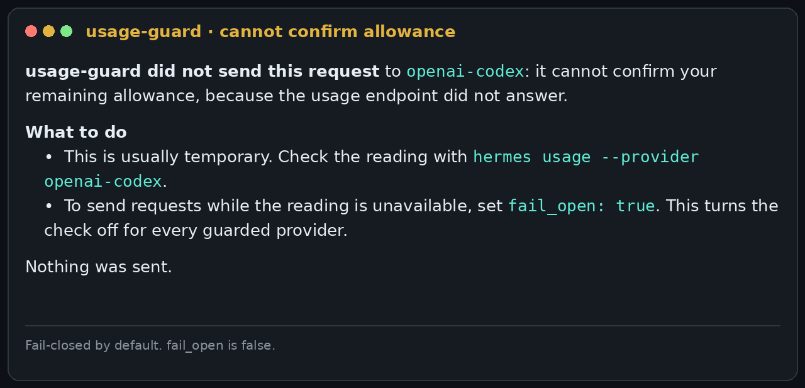

# usage-guard for Hermes Agent


[](https://github.com/mister-ideas/usage-guard/actions/workflows/ci.yml)
[](https://github.com/mister-ideas/usage-guard/releases)
[](LICENSE)

**Stop your Hermes agent at the subscription wall.** When a provider's usage window is used up, usage-guard refuses the next call instead of sending it, so an account that allows paid extra usage never spends overage by accident.

## See it



**When the wall is hit.** Nothing is sent, and the message says what to do next.



**Before the wall.** A short note reaches the agent at 80% and 90%, so it can finish or checkpoint the current work.



**When the reading is unavailable.** The guard refuses rather than guesses, and says why.



The screenshots use example values. Each one is rendered from the plugin's own message text, so the wording is exact.

## Quick start

Requires Hermes `>=0.21.6`. No Python dependencies, no API keys, no account changes.

```sh
hermes plugins install usage-guard     # from the Hermes plugin catalog
hermes plugins enable usage-guard
hermes gateway restart                 # middleware binds when the process starts
```

Install straight from this repository instead, or pin an exact reviewed commit with `--ref`:

```sh
hermes plugins install mister-ideas/usage-guard
```

Update and remove:

```sh
hermes plugins check-updates           # read-only: is a newer version available?
hermes plugins update usage-guard
hermes plugins remove usage-guard
```

Restart Hermes after an update. The catalog pins one reviewed commit, so an update reaches you only after a maintainer merges the new pin.

## What it does

- **Blocks at the wall.** It refuses a provider call once a subscription usage window reads fully used (default `threshold_percent: 100`). The request is not sent, so no paid overage is spent.
- **Warns before the wall.** At 80% and 90% one short note goes into the agent's context, so long work can wind down in time.
- **Fails closed.** A missing, malformed or stale reading is refused, not guessed. `fail_open` is off by default.
- **Survives rate limits.** A 429 from the usage endpoint never refuses a request by itself. The guard backs off and keeps using the last good reading for up to 15 minutes.
- **Covers long runs.** Every main-loop request is checked, including each step of a long tool-calling turn and subagent requests, not only the first prompt. MoA turns are checked against every guarded slot.
- **Optional output cap.** Near the wall it can lower the output budget so an in-flight request spills less. It is off by default, because a cap can cut an answer short.
- **Private.** It holds no credentials, makes no usage request of its own, and keeps one local cache file of windows and timestamps.

## How it compares

| Tool | What it does with usage | Stops a call at the wall? |
|---|---|---|
| `hermes usage` / `/usage` (native) | Shows the account's limit windows, once | No |
| Usage display plugins: usage-flame, provider-usage, usage-stats, model-usage-status, ai-usage-tracker, token-cost-meter | Live windows, chips and widgets in the Desktop status bar | No. None of these registers middleware, so none can refuse a call |
| lightningai-rate-limit | Throttles one provider's request rate (about 15 per minute) | No. It limits request rate and does not read subscription windows |
| **usage-guard** | Reads subscription windows, warns at 80% and 90%, and refuses the call at the wall | **Yes**, fail-closed |

This table covers usage and quota. I have not compared file-display or git-change features in this pass.

## Configuration

Settings live under `plugins.entries.usage-guard.settings`. The defaults are safe, and most users change nothing.

| Key | Default | What it does |
|---|---|---|
| `threshold_percent` | `100` | Refuse when a window reaches this percent used. Set `97` for a safety margin |
| `warn_percents` | `[80, 90]` | Levels that trigger the early note. `[]` turns it off |
| `fail_open` | `false` | Send requests when the reading is unavailable. Keep `false` unless you accept the risk |
| `provider_keys` | `["anthropic", "openai-codex"]` | Providers that are gated. Add custom provider IDs here |
| `max_tokens_near_wall` | `0` | Output cap near the wall. `0` is off |

The full table, with every key and its meaning, is in [docs/reference.md#configuration](docs/reference.md#configuration).

## Limits: what it cannot do

- **It cannot recall a request that is already running.** A request that starts inside the allowance and spills into paid usage within the same provider call is billed. The guard stops the next request.
- **It does not gate auxiliary calls on stock Hermes.** Compression, titles and background review are not covered. Core change [#140694](https://github.com/NousResearch/hermes-agent/pull/140694) would close that gap; it is open and not yet released.
- **It reads the account, not the request.** With credential pools or per-session overrides, treat the reading as account-level evidence.
- **It depends on undocumented usage endpoints** (Anthropic OAuth and Codex usage), which can change without notice.

Details: [docs/reference.md#what-stock-hermes-can-and-cannot-gate](docs/reference.md#what-stock-hermes-can-and-cannot-gate).

## Why it exists

Subscription plans now bill extra usage once a window is exhausted, and on many accounts it is switched on. An unattended agent is exactly the workload that spends it: it keeps working at 100% used, and the first request past the wall is billed. usage-guard makes the agent stop at the wall instead.

## Troubleshooting

| Symptom | What is happening | What to do |
|---|---|---|
| Blocked at a few percent | On stock Hermes, upstream's Anthropic parser scales any `utilization` ≤ 1 by 100, so a window at 0–1% can arrive as 100%. It hits every account right after a reset. | Nothing to fix here: it is [upstream's parser](https://github.com/NousResearch/hermes-agent/issues/58226), fixed by [PR #139916](https://github.com/NousResearch/hermes-agent/pull/139916). Until a release carries it: wait for the reset, or drop the provider from `provider_keys` if you accept it being ungated. |
| Blocked although usage looks fine | The window the notice names is at/over the threshold *in the snapshot the guard read*. The notice prints the label, the value and the reset time. | Read the notice: it names the window. Compare with `hermes usage`. A stale reset is never treated as replenishment. |
| Refused, notice says its settings are invalid | A setting has the wrong shape. A broken policy refuses by design rather than silently disabling the guard. | Fix `plugins.entries.usage-guard.settings`, or run `hermes plugins disable usage-guard`. The `plugins.usage-guard` log line names the setting. |
| Refused: "cannot confirm your remaining allowance" | The usage reading is missing, empty or stale beyond `stale_grace_s` (900s). The notice names the cause. | Run `hermes usage --provider <id>` to check the reading. Read the `plugins.usage-guard` log for detail. Set `fail_open: true` only if you accept sending without a reading. |
| It never blocks | The provider may not be listed in `provider_keys`, the window may genuinely be under the threshold, or the call may not be gated at all. | Check the log: the guard logs `usage-guard active: gating providers [...]` on its first guarded dispatch, and names each provider that passes through because it is not gated. See also [What stock Hermes can and cannot gate](docs/reference.md#what-stock-hermes-can-and-cannot-gate). |
| "reports no account usage to guard" warning | The account has no subscription usage surface — an Anthropic API-key account publishes no limits on the OAuth usage endpoint. | Expected: the provider passes through rather than being blocked. Remove it from `provider_keys` to silence the warning. |
| "usage endpoint rate-limiting" messages | The usage endpoint answered 429. The guard backs off (honouring `Retry-After`) and keeps deciding on the last good snapshot. | Nothing — a rate limit never refuses a request. Raising a floor or refreshing harder only deepens the backoff. |
| I need to unblock right now | — | Switch `/model` to another provider, wait for the reset, remove the provider from `provider_keys`, or `hermes plugins remove usage-guard`. |

## Development

```sh
python -m pip install -r requirements-dev.txt
python -m pytest tests -v          # offline suite (host-contract tests skip)
ruff check .
hermes plugins validate . --install-deps
python scripts/package.py          # dist/usage-guard-<version>.zip
```

Host-contract tests run against a real Hermes tree: point `HERMES_CORE` at a checkout (CI pins one):

```sh
HERMES_CORE=/path/to/hermes-agent python -m pytest tests/test_host_contract.py -v
```

See [CONTRIBUTING.md](CONTRIBUTING.md) and [SECURITY.md](SECURITY.md). Changelog: [CHANGELOG.md](CHANGELOG.md).

## Support, issues and releases

- Bugs and feature requests: the [issue forms](https://github.com/mister-ideas/usage-guard/issues/new/choose). The bug form asks for the refusal notice, your versions and the `plugins.usage-guard` log lines — that evidence is what makes a report reproducible.
- Questions and ideas: [Discussions](https://github.com/mister-ideas/usage-guard/discussions).
- Security: [SECURITY.md](SECURITY.md) — reported privately, never in a public issue.
- Community expectations: [CODE_OF_CONDUCT.md](CODE_OF_CONDUCT.md).
- Contributing: [CONTRIBUTING.md](CONTRIBUTING.md) — what is in and out of scope, and how releases are cut.

Releases are SemVer tags with a GitHub Release whose zip the release workflow builds only after the suite passes. There is no fixed cadence: fixes ship when they are ready. The Hermes plugin catalog pins an exact commit SHA, and moving that pin is a reviewed pull request against `NousResearch/hermes-agent`, so catalog users only ever receive reviewed code.

## License

MIT — see [LICENSE](LICENSE).
